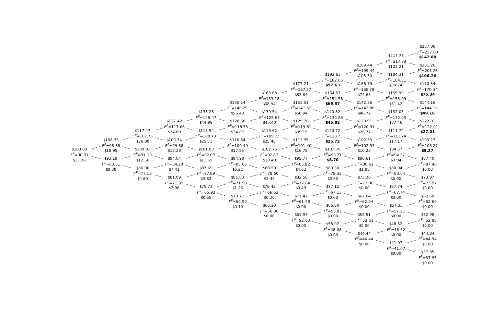
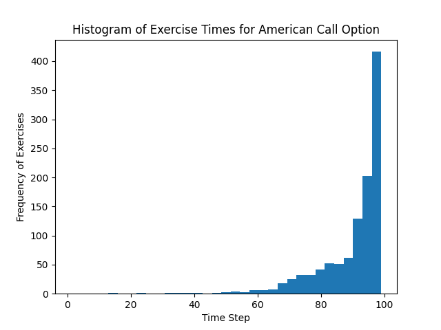
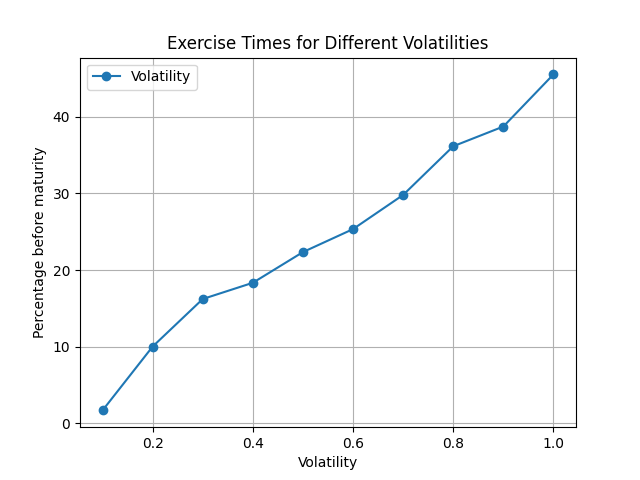

# Least Squares Monte Carlo (LSMC) Option Pricing Project

This project provides a modular Python implementation for pricing American and European options using:
- Least Squares Monte Carlo (LSM) with various regression approaches
- Binomial tree models (including discrete dividends)
- Black-Scholes formula

It is designed for flexibility, experimentation, and educational use.

## Project Structure

- `main.py` — Main script. Use command-line arguments to select which analysis to run.
- `config.py` — Centralized configuration for all example parameters (stock price, strike, volatility, etc.).
- `black_scholes.py` — Black-Scholes pricing and implied volatility functions.
- `binomial_tree.py` — Binomial tree pricing (American/European, discrete dividends, and tree plotting).
- `simulation.py` — Functions for simulating asset price paths (standard and antithetic variates).
- `lsm.py` — Longstaff-Schwartz LSM algorithm and regression utilities (polynomial, trigonometric, Hermite, etc.).
- `analysis.py` — Analysis and plotting functions (exercise time analysis, confidence intervals, etc.).
- `plots/` — Contains generated plots from simulations and analyses.
    - `binmoial_tree_11.png` — Example of a binomial tree visualization.
    - `exercise_times_histogram.png` — Histogram of exercise times for American options.
    - `percentage_plot.png` — Plot showing percentage of early exercises vs. volatility.

## Features & Analyses

- **Black-Scholes Pricing:** Analytical pricing for European options.
- **Binomial Tree Pricing:** American/European options, with and without discrete dividends. Includes tree visualization.
- **LSM Monte Carlo:** American option pricing using the Longstaff-Schwartz method, with support for multiple regression basis types.
- **Regression Approaches:** Compare polynomial, linear, exponential, trigonometric, Hermite, Legendre, Jacobi, and Laguerre regressions for LSM.
- **Exercise Time Analysis:** Analyze and plot when early exercise occurs, and how it depends on volatility.
- **Discrete Dividends:** Price options with discrete dividend payments and visualize the effect.

## Configuration

All example parameters (stock price, strike, volatility, etc.) are set in `config.py`. Edit this file to change the default values for your experiments.

## Usage

1. **Install dependencies:**
   ```bash
   pip install numpy scipy matplotlib scikit-learn pandas
   ```

2. **Run the main script with your chosen analysis:**
   ```bash
   python main.py --analysis [analysis]
   ```
   Where `[analysis]` is one of:
   - `all` — Run all analyses (default)
   - `binomial` — Binomial tree pricing
   - `black-scholes` — Black-Scholes pricing
   - `lsm` — LSM Monte Carlo pricing
   - `regression` — LSM with different regression approaches
   - `dividends` — Binomial tree with discrete dividends and plots
   - `mcdonald` — Recreates the textbook example from McDonald (2014), page 354, using the exact paths and parameters

   **Examples:**
   ```bash
   python main.py --analysis all
   python main.py --analysis binomial
   python main.py --analysis regression
   ```

3. **View Plots:**
   - Plots are saved in the `plots/` directory. Open them to visualize results (e.g., binomial trees, exercise histograms).

### McDonald (2014) Textbook Example

To reproduce the LSM example from page 354 of McDonald (2014), run:

```bash
python main.py --analysis mcdonald
```
This uses the exact paths and parameters from the book to verify the implementation against the published result.

## Extending the Project

- Add new pricing models or regression types by extending the relevant module.
- Adjust simulation parameters in `config.py` for custom experiments.
- Use the modular functions in your own scripts or notebooks for research or teaching.

## Example Output

- **Binomial Tree Visualization:**
  
- **Exercise Times Histogram:**
  
- **Percentage of Early Exercises vs. Volatility:**
  

## Notes
- The code is intended for educational and research purposes.
- For questions, suggestions, or contributions, please open an issue or pull request.
